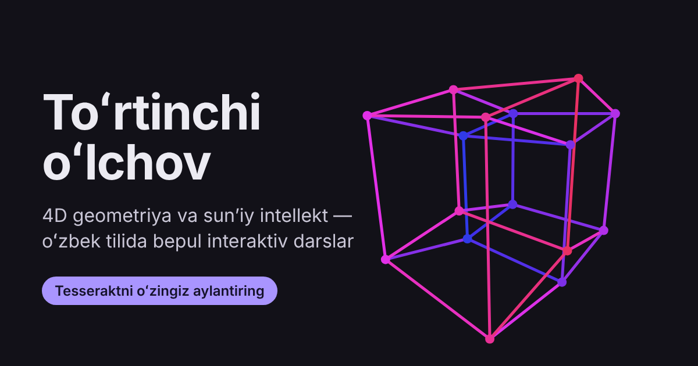
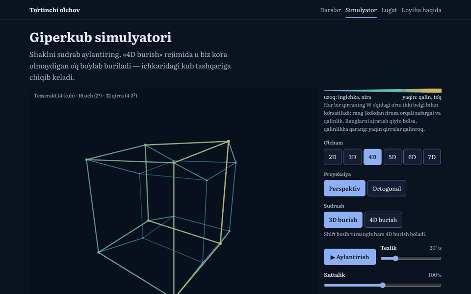

# Toʻrtinchi oʻlchov



**Oʻzbekcha** · [English](#english)

## Loyiha nima

Oʻzbek tilidagi bepul interaktiv sayt: toʻrt oʻlchamli geometriya va sunʼiy intellekt haqida. Asosiy foydalanuvchi — 13–16 yoshli maktab oʻquvchisi, telefonda.

- **6 ta qisqa dars:** nuqtadan tesseraktgacha → vektorlar → aylanish → perspektiv proyeksiya → amaliy topshiriq → AI embeddinglar va PCA.
- **Giperkub simulyatori:** 2D dan 7D gacha; sudrab, slayder yoki klaviatura bilan aylantirish, perspektiv va ortogonal proyeksiya.
- **Testlar:** har dars oxirida, hamda seminarlar uchun “oldin / keyin” testi.
- **Anonim statistika** (faqat rozilik bilan) va faqat oʻqiydigan **admin panel**.

Oddiy HTML, CSS va JavaScript: framework ham, build qadam ham yoʻq. Sayt GitHub Pagesʼda, statistika esa Supabaseʼda (bepul tarif) ishlaydi.

> Dars matnlari va testlar hozircha **qoralama** (`draft: true`). Muallif ularni oʻz soʻzlari bilan qayta yozadi.

## Holat

- [x] M1 — skelet va simulyator
- [x] M2 — darslar va testlar (qoralama)
- [x] M3 — anonim statistika ([docs/SETUP.md](docs/SETUP.md))
- [x] M4 — admin panel (`admin.html`)
- [x] M5 — sayqal va joylash ([docs/DEPLOY.md](docs/DEPLOY.md))

## Skrinshotlar

<!-- Muallif: telefon va kompyuterdan olingan skrinshotlarni docs/screenshots/ papkasiga qoʻying va shu yerga qoʻshing, masalan:

-->

*[Bu yerga skrinshotlar qoʻyiladi: bosh sahifa, simulyator, dars, admin panel.]*

## Lokal ishga tushirish

Sayt **albatta server orqali** ochilishi kerak. Repo papkasida:

```bash
python -m http.server 8000     # Windows
python3 -m http.server 8000    # macOS / Linux
```

Keyin brauzerda oching: <http://localhost:8000>

`index.html` ni ikki marta bosib (`file://` orqali) ochsangiz, sayt ishlamaydi: brauzer ES modullarni ham, darslarni `fetch()` bilan yuklashni ham faqat `http://` orqali ruxsat beradi.

Statistika uchun Supabase kerak — [docs/SETUP.md](docs/SETUP.md). Sozlanmasa, sayt baribir toʻliq ishlaydi.

## Testlar

Node.js 18 yoki yangisi kerak, hech narsa oʻrnatish shart emas:

```bash
npm test        # yoki: node --test
```

Testlar internetsiz ishlaydi. Ular matematikani, Markdown parserni, quiz baholashni, statistika va admin hisob-kitoblarini, xavfsizlik qoidalarini, meta teglarni va imloni tekshiradi. Supabase xavfsizlik testi alohida: `supabase/rls-test.sql` (SQL Editorʼda ishga tushiriladi).

## Fayl tuzilmasi

```
index.html, lesson.html, simulator.html,   sahifalar
test.html, glossary.html, about.html,
privacy.html, admin.html, 404.html
css/       style.css (umumiy), content.css (darslar), admin.css
js/        math4d.js (4D matematika), simulator.js, lesson.js, markdown.js,
           quiz.js, analytics.js, stats.js, admin.js va boshqalar
content/   lessons/1–6.md, quizzes/1–6.json, tests/prepost.json
supabase/  schema.sql (jadvallar va RLS), rls-test.sql
tests/     node --test testlari
tools/     og-image.html (ulashish rasmi generatori)
docs/      ARCHITECTURE.md, SETUP.md, DEPLOY.md, TEKSHIRISH.md, LOYIHA-TARIXI.md
```

Har bir fayl nima qilishi va nega shunday qilingani: [docs/ARCHITECTURE.md](docs/ARCHITECTURE.md).

## Hujjatlar

- [docs/SETUP.md](docs/SETUP.md) — Supabaseʼni sozlash va xavfsizlik tekshiruvi
- [docs/DEPLOY.md](docs/DEPLOY.md) — GitHub Pagesʼga joylash, tekshiruv roʻyxati va Lighthouse
- [docs/TEKSHIRISH.md](docs/TEKSHIRISH.md) — oʻqituvchi bilan tekshirilishi kerak boʻlgan faktlar va qarorlar
- [docs/LOYIHA-TARIXI.md](docs/LOYIHA-TARIXI.md) — loyiha bosqichlari

## AI yordami

*[Bu boʻlimni muallif oʻzi yozadi: qaysi qismlar Claude (AI) yordamida yozilgani, qaysilarini muallif oʻzi yozgani va tekshirgani.]*

## Litsenziya

Kod — MIT, dars matnlari va testlar (`content/`) — CC BY 4.0. Qarang: [LICENSE](LICENSE).

## Muallif

Sanjar Abdubositov.

*[Muallif oʻzi haqida bir-ikki gap qoʻshadi.]*

---

<a id="english"></a>

# The Fourth Dimension (English)

A free, interactive website in Uzbek about four-dimensional geometry and artificial intelligence, built for 13–16-year-old students who mostly use phones.

- **Six short lessons:** from a point to a tesseract → vectors → rotation → perspective projection → hands-on activities → AI embeddings and PCA.
- **Hypercube simulator:** 2D to 7D; rotate by dragging, with sliders or with the keyboard; perspective and orthographic projection.
- **Quizzes** after each lesson and a pre/post test for workshops.
- **Anonymous, consent-based analytics** and a read-only **admin dashboard**.

Plain HTML, CSS and JavaScript — no framework, no build step. Hosted on GitHub Pages; analytics are stored in Supabase (free tier).

> Lesson texts and quizzes are still **drafts** (`draft: true`); the author will rewrite them in their own words.

## Screenshots

*[Screenshots will be added here.]*

## Run locally

The site must be served over HTTP:

```bash
python -m http.server 8000     # Windows
python3 -m http.server 8000    # macOS / Linux
```

Then open <http://localhost:8000>. Opening `index.html` directly (`file://`) does not work, because browsers only load ES modules and `fetch()` lesson files over HTTP. Analytics need Supabase ([docs/SETUP.md](docs/SETUP.md)); without it the site still works fully.

## Tests

Requires Node.js 18+; nothing to install:

```bash
npm test        # or: node --test
```

The tests run offline and cover the 4D math, the Markdown parser, quiz grading, analytics and admin statistics, security rules, page meta tags and Uzbek spelling. The database security test is separate: `supabase/rls-test.sql` (run it in the Supabase SQL Editor).

## Project structure

See the tree above and [docs/ARCHITECTURE.md](docs/ARCHITECTURE.md) (in Uzbek) for what each file does and why.

## AI assistance

*[The author will write this section: which parts were written with help from Claude (AI), and which parts the author wrote and checked.]*

## License

Code: MIT. Lesson texts and quizzes (`content/`): CC BY 4.0. See [LICENSE](LICENSE).

## Author

Sanjar Abdubositov.
