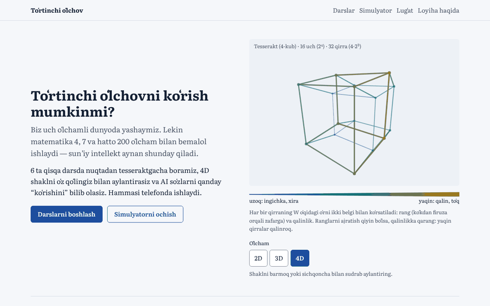
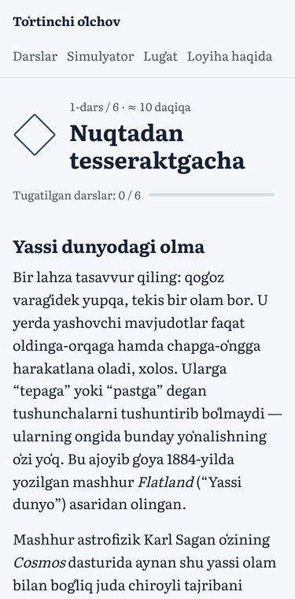
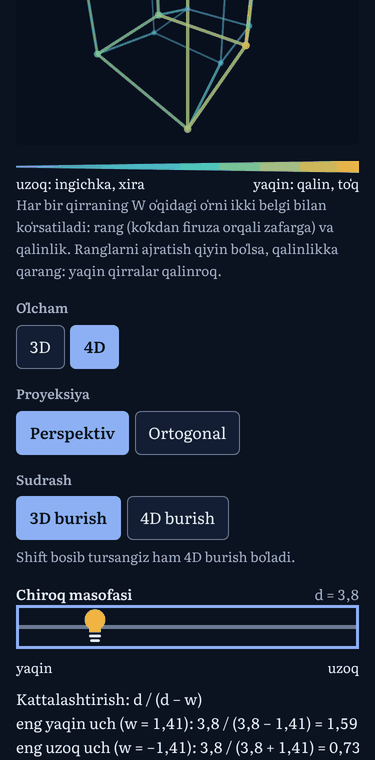

# Toʻrtinchi oʻlchov


**Sayt:** <https://sanjarabdubositov.github.io/Dimensions/>

**Oʻzbekcha** · [English](#english)

## Loyiha nima

Oʻzbek tilidagi bepul interaktiv sayt: toʻrt oʻlchamli geometriya va sunʼiy intellekt haqida. Sodda tilda yozilgan — mavzuga qiziqqan har kim tushuna oladi. Telefonda ham ishlaydi.

- **6 ta qisqa dars:** nuqtadan tesseraktgacha → vektorlar → aylanish → perspektiv proyeksiya → amaliy topshiriq → AI embeddinglar va PCA.
- **Giperkub simulyatori:** 2D dan 7D gacha; sudrab, slayder yoki klaviatura bilan aylantirish, perspektiv va ortogonal proyeksiya.
- **Testlar:** har dars oxirida, hamda seminarlar uchun “oldin / keyin” testi.
- **Anonim statistika** (faqat rozilik bilan) va faqat oʻqiydigan **admin panel**.

Oddiy HTML, CSS va JavaScript: framework ham, build qadam ham yoʻq. Sayt GitHub Pagesʼda, statistika esa Supabaseʼda (bepul tarif) ishlaydi.

Darslar va testlarni muallif oʻzi yozgan.

## Holat

- [x] M1 — skelet va simulyator
- [x] M2 — darslar va testlar (muallif qayta yozdi)
- [x] M3 — anonim statistika ([docs/SETUP.md](docs/SETUP.md))
- [x] M4 — admin panel (`admin.html`)
- [x] M5 — sayqal va joylash ([docs/DEPLOY.md](docs/DEPLOY.md))
- [x] Dizayn — “Koshin”: Samarqand koshinlari ranglari, Literata shrifti, matematik hisoblangan rozetkalar

## Skrinshotlar




 

Dizayn oldin va keyin: [docs/dizayn/](docs/dizayn/).

## Lokal ishga tushirish

Sayt **albatta server orqali** ochilishi kerak. Repo papkasida:

```bash
python -m http.server 8000     # Windows
python3 -m http.server 8000    # macOS / Linux
```

Keyin brauzerda oching: <http://localhost:8000>

`index.html` ni ikki marta bosib (`file://` orqali) ochsangiz, sayt ishlamaydi: brauzer ES modullarni ham, darslarni `fetch()` bilan yuklashni ham faqat `http://` orqali ruxsat beradi.

Statistika uchun Supabase kerak — [docs/SETUP.md](docs/SETUP.md). Sozlanmasa, sayt baribir toʻliq ishlaydi.

## Testlar

Node.js 18 yoki yangisi kerak, hech narsa oʻrnatish shart emas:

```bash
npm test        # yoki: node --test
```

Testlar internetsiz ishlaydi. Ular matematikani, Markdown parserni, quiz baholashni, statistika va admin hisob-kitoblarini, xavfsizlik qoidalarini, meta teglarni va imloni tekshiradi. Supabase xavfsizlik testi alohida: `supabase/rls-test.sql` (SQL Editorʼda ishga tushiriladi).

## Fayl tuzilmasi

```
index.html, lesson.html, simulator.html,   sahifalar
test.html, glossary.html, about.html,
privacy.html, admin.html, 404.html
css/       style.css (umumiy), content.css (darslar), admin.css
js/        math4d.js (4D matematika), simulator.js, lesson.js, markdown.js,
           quiz.js, analytics.js, stats.js, admin.js va boshqalar
content/   lessons/1–6.md, quizzes/1–6.json, tests/prepost.json
supabase/  schema.sql (jadvallar va RLS), rls-test.sql
tests/     node --test testlari
tools/     og-image.html (ulashish rasmi generatori)
docs/      ARCHITECTURE.md, SETUP.md, DEPLOY.md, TEKSHIRISH.md, LOYIHA-TARIXI.md
```

Har bir fayl nima qilishi va nega shunday qilingani: [docs/ARCHITECTURE.md](docs/ARCHITECTURE.md).

## Hujjatlar

- [docs/SETUP.md](docs/SETUP.md) — Supabaseʼni sozlash va xavfsizlik tekshiruvi
- [docs/DEPLOY.md](docs/DEPLOY.md) — GitHub Pagesʼga joylash, tekshiruv roʻyxati va Lighthouse
- [docs/TEKSHIRISH.md](docs/TEKSHIRISH.md) — oʻqituvchi bilan tekshirilishi kerak boʻlgan faktlar va qarorlar
- [docs/LOYIHA-TARIXI.md](docs/LOYIHA-TARIXI.md) — loyiha bosqichlari

## AI yordami

Bu saytni Claude (Anthropic kompaniyasining sunʼiy intellekti) yordamida tuzdim.

**Oʻzim nima qildim:** gʻoyani oʻylab topdim, qaysi mavzular kirishini tanladim va 6 ta dars hamda ular uchun testlarni oʻzim yozdim. Har bir bosqichda Claudeʼga nimani bajarishni aytdim, natijasini koʻrib chiqib, kerak boʻlsa toʻgʻriladim. Dizayn uchun ham uchta variantdan birini oʻzim tanladim.

**Claude nima qildi:** saytning kodini yozdi — 2D dan 7D gacha aylanadigan simulyator, uning matematikasi, statistikasi va admin panelini ham tayyorladi. Dizaynni ham chizdi, lugʻat va maxfiylik sahifasini yozib chiqdi.

Xullas, men oʻqituvchi sifatida dars mazmuniga javob berdim, Claude esa barcha texnik ishlarni bajardi.

## Litsenziya

Kod — MIT, dars matnlari va testlar (`content/`) — CC BY 4.0. Qarang: [LICENSE](LICENSE).

## Muallif

Men Sanjar Abdubositov, 15 yoshman. “Synergy School”da 9-sinf oʻquvchisiman. Dasturlash, matematika va fizikaga qiziqaman.

Bir kuni toʻrtinchi oʻlchov haqida osonroq, tushunarli manba izlab koʻrdim, lekin oʻzbek tilida topa olmadim. Shuning uchun hammasini boshidan oson, koʻrgazmali va oʻzbek tilida tushuntirib berishga bel bogʻladim.

Bogʻlanish: Telegram [@AbdubositovSanjar](https://t.me/AbdubositovSanjar).

---

<a id="english"></a>

# The Fourth Dimension (English)

A free, interactive website in Uzbek about four-dimensional geometry and artificial intelligence. It is written in simple language for anyone curious about the topic, and works well on phones.

**Live site:** <https://sanjarabdubositov.github.io/Dimensions/>

- **Six short lessons:** from a point to a tesseract → vectors → rotation → perspective projection → hands-on activities → AI embeddings and PCA.
- **Hypercube simulator:** 2D to 7D; rotate by dragging, with sliders or with the keyboard; perspective and orthographic projection.
- **Quizzes** after each lesson and a pre/post test for workshops.
- **Anonymous, consent-based analytics** and a read-only **admin dashboard**.

Plain HTML, CSS and JavaScript — no framework, no build step. Hosted on GitHub Pages; analytics are stored in Supabase (free tier).

The lessons and quizzes were written by the author.

## Screenshots

See the screenshots in the Uzbek section above.

## Run locally

The site must be served over HTTP:

```bash
python -m http.server 8000     # Windows
python3 -m http.server 8000    # macOS / Linux
```

Then open <http://localhost:8000>. Opening `index.html` directly (`file://`) does not work, because browsers only load ES modules and `fetch()` lesson files over HTTP. Analytics need Supabase ([docs/SETUP.md](docs/SETUP.md)); without it the site still works fully.

## Tests

Requires Node.js 18+; nothing to install:

```bash
npm test        # or: node --test
```

The tests run offline and cover the 4D math, the Markdown parser, quiz grading, analytics and admin statistics, security rules, page meta tags and Uzbek spelling. The database security test is separate: `supabase/rls-test.sql` (run it in the Supabase SQL Editor).

## Project structure

See the tree above and [docs/ARCHITECTURE.md](docs/ARCHITECTURE.md) (in Uzbek) for what each file does and why.

## AI assistance

*(Translated from the author’s Uzbek text.)*

I built this site with the help of Claude, an AI made by Anthropic.

**What I did:** I came up with the idea, chose the topics, and wrote all six lessons and their quizzes myself. At every stage I told Claude what to build, reviewed the result and asked for changes where needed. I also chose the design direction from three options.

**What Claude did:** it wrote the site’s code — the 2D-to-7D simulator, its math, the analytics and the admin dashboard. It also designed the site and wrote the glossary and the privacy page.

In short: I was responsible for the teaching content, and Claude did the technical work.

## License

Code: MIT. Lesson texts and quizzes (`content/`): CC BY 4.0. See [LICENSE](LICENSE).

## Author

Sanjar Abdubositov, 15, a 9th-grade student at Synergy School. I’m interested in programming, math and physics. I couldn’t find a clear explanation of the fourth dimension in Uzbek, so I decided to make one — simple, visual and interactive.
